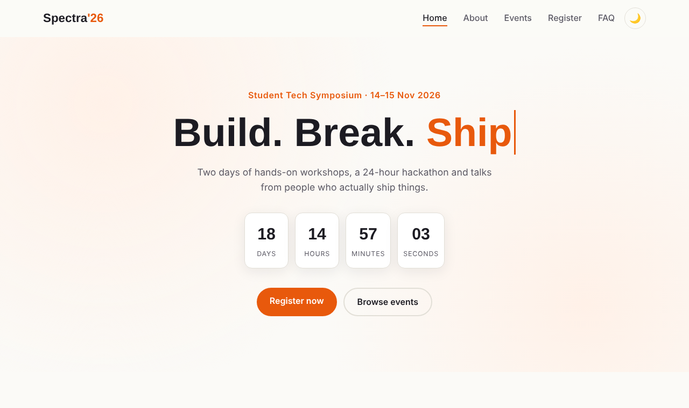
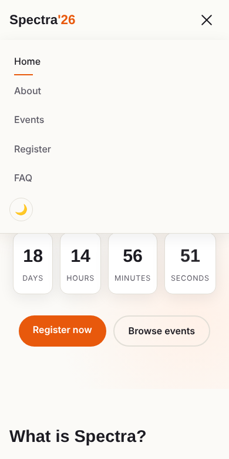
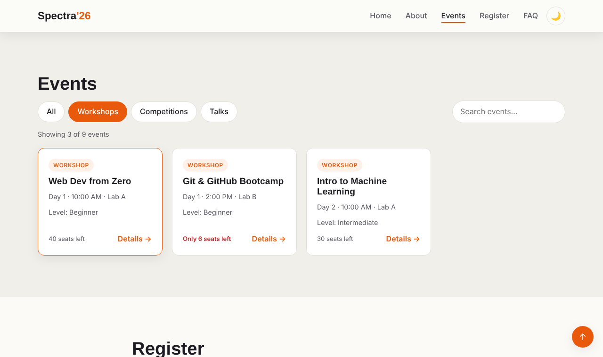
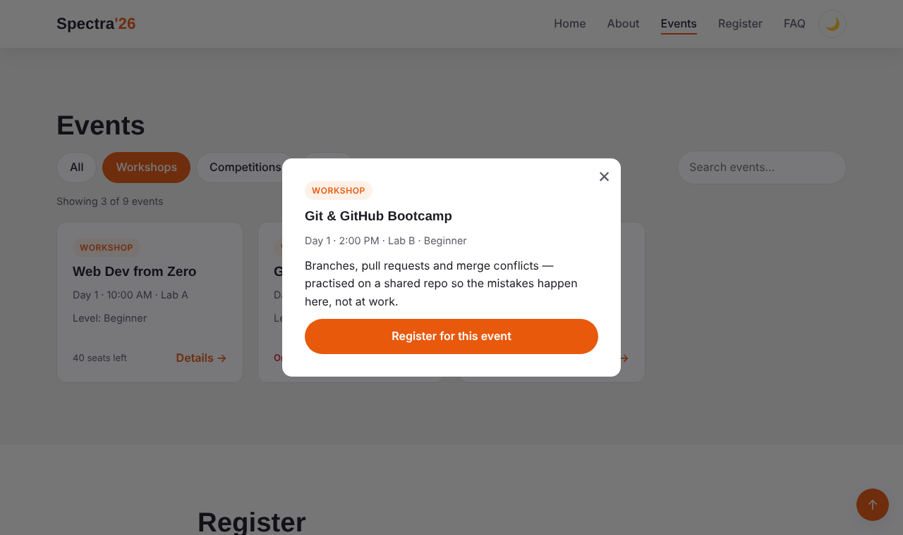
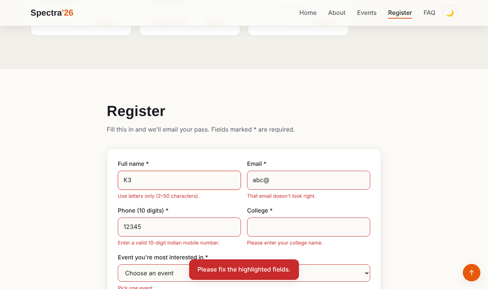
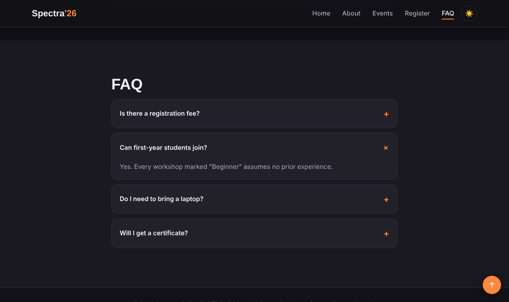

# Spectra '26 — JavaScript Interactivity (Week 3)

A landing page for a fictional student tech symposium. The goal of this task was to take a static HTML/CSS page and make it interactive using **plain JavaScript only**. No frameworks or libraries are used.

## Features

| # | Feature | What it does |
|---|---------|--------------|
| 1 | Theme toggle | Switches between light and dark mode. The choice is saved in `localStorage`, and the first visit follows the OS setting. |
| 2 | Mobile menu | Hamburger button that animates into an ✕ and slides the menu down. It closes when you pick a link or tap outside it. |
| 3 | Active nav link | The link for the section you are viewing is highlighted while you scroll (`IntersectionObserver`). |
| 4 | Typing effect | The hero headline cycles through words letter by letter. |
| 5 | Countdown | A live timer to the event start that updates every second. |
| 6 | Stat counters | Numbers count up once, when the section first scrolls into view. |
| 7 | Dynamic event cards | Cards are generated from a JavaScript array. Category filter tabs and a live search (debounced) narrow them down. |
| 8 | Event modal | Shows full details. It closes with Esc, the ✕ button or a click outside, and focus stays inside it while open. |
| 9 | Form validation | Real-time checks for name, email, phone, college, event choice and consent. Errors are shown inline, along with a character counter and a simulated submit. |
| 10 | FAQ accordion | One answer opens at a time with a smooth height animation. |
| 11 | Extras | Scroll-reveal animations, toast messages, a back-to-top button and a reduced-motion fallback. |

## Folder structure

```
spectra-week3/
├── index.html          # Page structure
├── css/
│   └── style.css       # Styling, themes, animations, responsive rules
├── js/
│   └── script.js       # All interactivity
├── docs/
│   └── TECHNICAL_DOCUMENTATION.md
└── README.md
```

## How to run

There is no build step.

1. Clone the repo:
   ```bash
   git clone https://github.com/keerthanagovindarajanhere-create/week3-javascript-interactivity.git
   ```
2. Open `index.html` in any modern browser. For an auto-reloading setup, you can also use the VS Code **Live Server** extension.

## Tech used

HTML5 · CSS3 (custom properties, Grid, Flexbox, keyframe animations) · Vanilla JavaScript (ES6+)

## Documentation

`docs/TECHNICAL_DOCUMENTATION.md` explains how each feature works, why I made the choices I did, and the bugs I ran into.

## Screenshots

| Desktop | Mobile |
|---|---|
|  |  |
|  |  |
|  |  |
